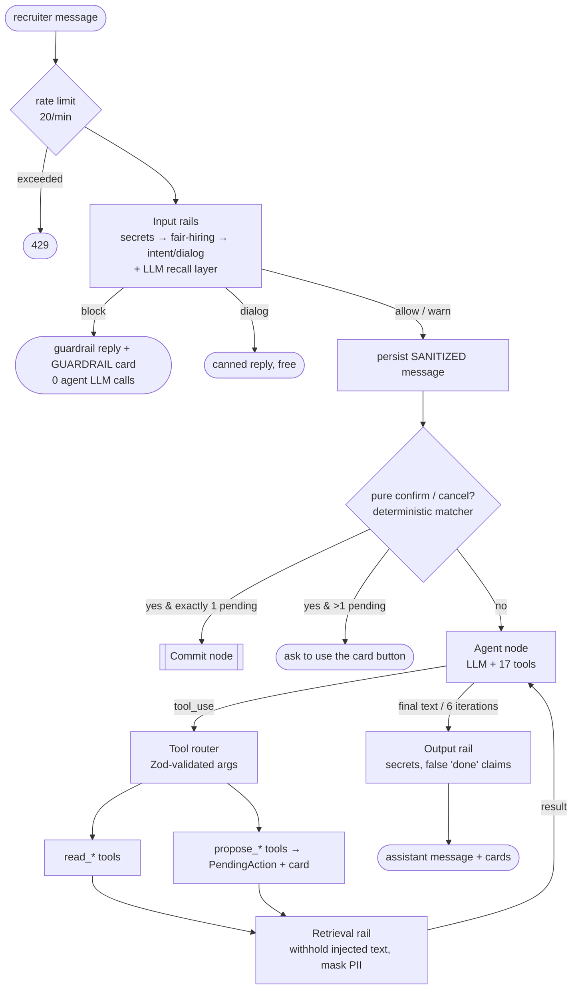
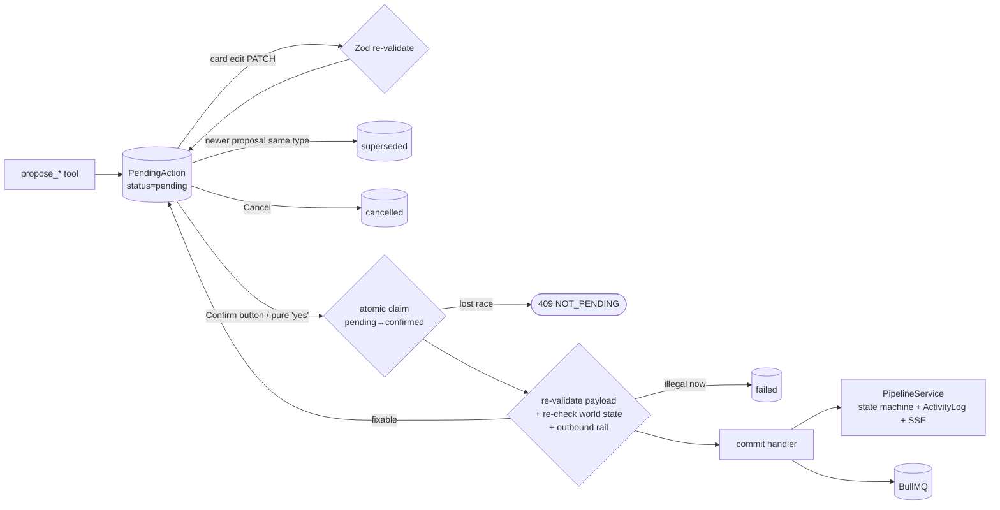
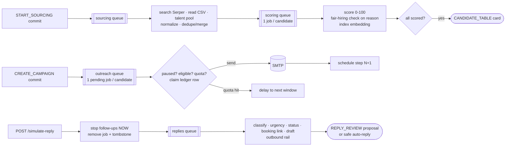

# Agent graph: nodes, edges and stages

AiroRecruit does **not** use LangChain or LangGraph. The agent is plain tool calling on top of a deterministic
service layer. It is still a graph with explicit nodes, conditional edges and durable state; the graph is just
written as code instead of a framework DSL. This document is that graph.

## Which of the brief's agent approaches, and why

The brief offers four: *LangGraph, Vercel AI SDK, plain tool calling, or your own*. This project is **plain tool
calling (an agent loop with 17 typed tools) + our own deterministic orchestration**: two of the four listed
options, combined deliberately. It is a real agent: the model decides which tools to call, in what order, and how
to resolve what the recruiter means, for up to 6 steps per turn. What it does *not* do is own state or side effects.

| Option | Fit for this product | Verdict |
|---|---|---|
| **LangGraph** | Strong for long LLM-driven plans with checkpoints. Here the pauses are human clicks, workers and replies arriving days later, already durable in Mongo + BullMQ. Its checkpointer would be a second source of truth, and HITL would rely on `interrupt()` placement being right in every path. | Not chosen: duplicates state and makes the safety guarantee depend on graph wiring |
| **Vercel AI SDK** | Excellent streaming UI helpers (`useChat`, generative UI) for Next.js. Our backend is Express + BullMQ with SSE, and cards are persisted state rather than streamed components, so its main advantage doesn't apply. It also only covers OpenAI-style providers through adapters we'd still need to wrap for cost tracking and guardrails. | Not chosen for the backend; a valid choice for the React client if it were Next.js |
| **Plain tool calling** | Full control over the loop: Zod-validated arguments, retrieval rail on every tool result, iteration cap, per-call cost and prompt-version telemetry, provider-neutral (Claude / OpenAI / Gemini / Groq / offline). | **Chosen** for the agent loop |
| **Own orchestration** | Proposal → commit, a state machine with atomic transitions, idempotent queues, deterministic confirmation matching and candidate resolution. These are correctness properties that must not depend on model behaviour. | **Chosen** for everything that writes or sends |

The design rule behind the split: *the model decides what to propose; code decides what is allowed to happen.*

## Why not LangGraph?

LangGraph shines when the *LLM's own reasoning* is a long, branching, resumable process (multi-day plans,
checkpointed sub-agents). In this product the long pauses come from **outside** the model:

| Pause | Lasts | Resumed by |
|---|---|---|
| recruiter reviews a proposal card | seconds to days | a button click / "confirm" |
| sourcing + scoring | seconds to minutes | BullMQ workers |
| a campaign follow-up | days | a delayed BullMQ job |
| a candidate reply | hours to weeks | `POST /simulate-reply` (an inbox webhook in production) |

That state already lives in MongoDB (`PendingAction`, `SourcingRun`, `Campaign`, `DispatchLog`, `Reply`) and
BullMQ, both of which are durable, queryable and idempotent. A LangGraph checkpointer would duplicate it. More
importantly, the human-in-the-loop guarantee is **structural**: the model has no commit tool, so there is no
graph edge from the LLM to a write. With an LLM-driven graph that guarantee would rest on the graph definition
being right; here the commit node is simply unreachable from the model.

What we keep from the graph mindset: typed state, explicit nodes, conditional edges, bounded loops (max 6 tool
iterations), and every edge observable (activity log, guardrail events, LLM usage, SSE).

## 1. Turn graph: one recruiter message

**State** (per turn): conversation, active job, sanitized message, tool trace, cards, proposal ids.
**Loop bound:** `AGENT_MAX_ITERATIONS` (6). **Model tiers:** agent tier for routing and drafting, fast tier for
classification and scoring.

## 2. Proposal → Commit graph (the HITL boundary)

Commit handlers: `CREATE_JOB`, `START_SOURCING`, `REVIEW_DECISIONS`, `CREATE_CAMPAIGN`, `STATUS_CHANGE`,
`SEND_REPLY`, `CAMPAIGN_CONTROL`, `UPDATE_JOB_SETTINGS`, `UPDATE_CANDIDATE_EMAIL`. Only the human actors
(`user_ui`, `user_chat`) can reach them; `GET /api/ops/metrics → hitl.nonHumanConfirmations` must stay 0.

## 3. Pipeline graph: background stages

## 4. Candidate state machine (the business graph)

`Sourced → Accepted / Rejected(review) → Contacted → Replied → Interested / NotInterested → MeetingBooked →
Interviewed → Shortlisted → Hired / Rejected(final)`, with `Unsubscribed` reachable from every post-contact
state. The table is in `src/domain/pipeline.ts`; every edge is enforced by an atomic compare-and-set in
`PipelineService.transition` and logged in the append-only `ActivityLog`.

## Where an LLM is used (and where it is not)

| Node | LLM | Tier | Output contract |
|---|---|---|---|
| Agent routing | yes | agent | tool calls (Zod-validated) |
| JD extraction | yes | fast | JSON schema |
| Candidate scoring | yes | fast | JSON schema, 1 repair retry, never invents a score |
| Outreach & reply drafts | yes | agent | JSON schema + outbound rail |
| Reply classification | yes | fast | JSON schema |
| Guardrail recall layer | yes | fast | JSON schema (intent + confidence) |
| Job summary | yes | agent | JSON schema, numbers only from metrics |
| Rails, state machine, confirmation, dedupe, quotas, idempotency, preemption, candidate-name resolution | **no** | | deterministic code |
| Talent rediscovery | embeddings only (on-device MiniLM) | | cosine search (Qdrant or MongoDB) |
