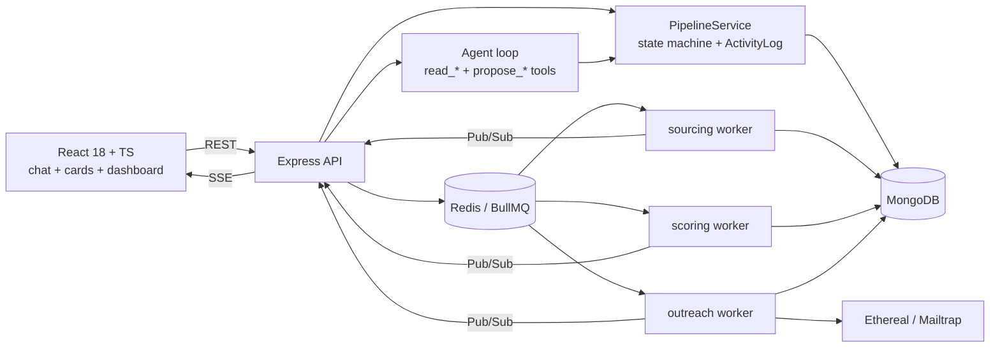

# AiroRecruit: AI Recruiting Co-Worker

A chat-first assistant that runs a recruiter's hiring process from job description to hire. Heavy work runs in BullMQ background jobs, and nothing is written or sent without the recruiter's approval.

**Demo video:** `<link>` · **Frontend repo:** https://github.com/Emon3469/airorecruit-frontend · **Backend repo:** https://github.com/Emon3469/airorecruit-backend

---

## Quick start

```bash
git clone https://github.com/Emon3469/airorecruit-backend && cd airorecruit-backend
cp .env.example .env        # add LLM_API_KEY and SERPER_API_KEY
docker compose up --build   # mongo, redis, api, worker

# frontend (separate repo)
git clone https://github.com/Emon3469/airorecruit-frontend && cd airorecruit-frontend
cp .env.example .env        # VITE_API_URL=http://localhost:4000
npm i && npm run dev        # http://localhost:5173
```

**Seed data:** `seed/sample-jd.txt` and `seed/candidates.csv` (includes one duplicate row, one row with no email, and one row containing a prompt-injection string on purpose).

**Without a Serper key:** web sourcing is skipped with a clear message and CSV upload still works.

### Environment variables

| Variable | Purpose |
|---|---|
| `LLM_PROVIDER`, `LLM_API_KEY` | chosen provider and key |
| `LLM_MODEL_AGENT` | conversational tool-routing and drafting model |
| `LLM_MODEL_FAST` | batch scoring and reply classification model |
| `SERPER_API_KEY` | web discovery |
| `MONGO_URI`, `REDIS_URL` | datastores |
| `SMTP_*` | Ethereal/Mailtrap credentials (auto-generates an Ethereal account if blank) |
| `DAILY_SEND_LIMIT` | default per-campaign daily cap |
| `PRICE_TABLE_JSON` | per-model token prices for cost tracking |

---

## Architecture



Full detail (models, transitions, routes, queue logic): see [`ARCHITECTURE.md`](./ARCHITECTURE.md).

### Key ideas

1. **Propose / commit.** The agent can only read and *propose*. Proposals are stored as `PendingAction` documents and shown as cards. Commits run only from the confirm endpoint, which a card button or a deterministic chat confirmation reaches. The LLM has no commit tool, so "confirm before any write or send" is enforced by code, not by a prompt.
2. **One write path.** Chat commands, UI buttons and workers all go through `PipelineService`, so the state machine, activity log and `state_sync` events behave identically everywhere.
3. **SSE as a hint.** State is persisted. SSE only tells the UI to refresh, so a page refresh never loses anything.

## How the agent works

`<describe: system prompt, tool list, max 6 iterations per turn, how candidate references like "Rahim" or "top 5" are resolved server-side, how confirmations are matched>`

## How background jobs work

- **sourcing-queue:** Serper search plus CSV import, normalized and deduplicated via unique partial indexes on `emailLower` and `profileUrlCanonical`.
- **scoring-queue:** one job per candidate, a Zod-validated `{score, reason, missingData}` result, one repair retry, never an invented score.
- **outreach-queue:** one pending job per candidate. Step N+1 is scheduled only after step N is sent.
  - Idempotency: unique `{campaignId, candidateId, stepNumber}` ledger, claimed **before** the SMTP call.
  - Daily limit: counted from the ledger. When it is hit, the job is delayed to the next day.
  - Reply/unsubscribe: `outreachStopped` plus removal of the pending job, with a worker re-check as the real guarantee.
- All queues use 3 attempts with exponential backoff.

## Why this LLM and agent approach

**LLM:** `<provider>`, two tiers: a stronger model (`<name>`) for tool routing and personalized drafting, and a cheaper, faster model (`<name>`) for high-volume scoring and classification, where cost and latency dominate and the output is a small schema-locked JSON.

**Agent framework: plain tool calling, no graph framework.** The workflow pauses on external events (background workers, button clicks) rather than on LLM reasoning. A deterministic service layer with propose/commit tools gives fully predictable control flow, direct token and cost accounting, and straightforward debugging, without the extra abstraction a graph framework would add here. `<add one sentence on what you'd reach for if the workflow needed long-running agent plans>`

## Safety and data integrity

- **No invented data.** Web-sourced candidates have `email: null` until enriched through CSV or manual edit. Every field carries its source. Only Accepted candidates with an email can join a campaign.
- **Prompt injection.** Candidate text and replies are wrapped as untrusted data and only reach tool-less, schema-locked LLM calls. A heuristic flag warns the recruiter, but the real defense is structural: those calls cannot take actions, and every send still needs approval.
- **No LinkedIn scraping.** Discovery uses Serper `site:linkedin.com/in` queries (URL, title and snippet only) plus CSV.

## What is done / mocked / skipped

| Area | Status | Notes |
|---|---|---|
| Chat UI with persistent cards (job, progress, table, campaign, reply) | Done | |
| JD (text or URL) → job | Done | |
| Sourcing (Serper + CSV), dedupe, 0–100 scoring, live progress | Done | |
| Review via buttons and chat | Done | |
| Multi-step campaign, daily limit, idempotent sending | Done | Ethereal SMTP |
| Reply classification, auto-stop, draft + approval | Done | Via `POST /api/simulate-reply` and UI |
| Meeting booking | Mocked | Mock slot picker at `/booking/:token`; status becomes *Meeting booked* when a slot is picked |
| Real inbox (IMAP/Gmail) | Skipped | Replaced by simulate-reply |
| Dashboard and AI summary | Done | |
| Token/cost per job | `<Done/Skipped>` | |
| Pause/resume | `<Done/Skipped>` | |
| Auto-reply setting with safety rules | `<Done/Skipped>` | |
| Prompt-injection protection | Done | |
| Auth / multi-tenancy | Skipped | Single-user demo |

## Evaluation

`npm run eval:replies` classifies 20 labeled replies (3 injection attempts, 2 ambiguous).

`<paste accuracy table and confusion matrix>`

## Trade-offs and known limitations

- **At-most-once sending.** A crash between SMTP success and the ledger update skips that step on retry. Chosen over risking a duplicate email.
- **Thin search data.** Serper snippets are short, so web-sourced scores carry lower confidence, are flagged, and are shown with the missing data.
- **Chat confirmation is deliberately strict.** If more than one proposal is pending, chat confirmation is refused and the user is pointed to the card button.
- **Single-instance SSE hub.** Redis Pub/Sub makes workers independent, but a multi-instance deployment would need sticky sessions or a shared fan-out layer.
- `<add anything you cut for time>`
